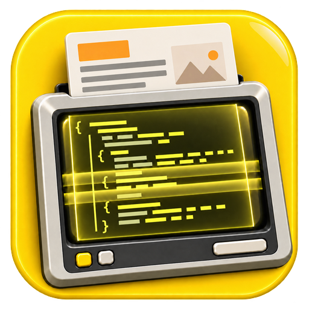

# X-Ray

[](https://www.nuget.org/packages/X-Ray/)
[](https://xray.curiosity.ai/)

X-Ray is a family of pure C# NuGet packages for .NET 10, from Curiosity GmbH, for working with
documents: extracting their content for search and LLMs, rendering them to PDF and images, and
reading specific file types (Photoshop, Outlook email, PostScript/XPS, OneNote) in depth. No
office suite or other application has to be installed. The core of each package is managed
code; where a native library is needed (SkiaSharp, HarfBuzz, PDFium), it sits in an optional
package or behind an opt-in option.

This repository is the family's root. It holds the `X-Ray` umbrella package, the
documentation site, and the notes and skills shared by everyone working across the family.
The packages themselves live in the repositories below.

**Documentation: <https://xray.curiosity.ai/>**

## Packages

| Package | What it does | Repository | License |
|---|---|---|---|
| [`X-Ray`](https://www.nuget.org/packages/X-Ray/) | The umbrella. No code; installs every package below. | [x-ray](https://github.com/curiosity-ai/x-ray) (this one) | covers its members |
| [`X-Ray.Content`](https://www.nuget.org/packages/X-Ray.Content/) | Content extraction for search and LLM use: text, Markdown, HTML, JSON, metadata, tables and images from 90+ formats. A C# port of the Rust xberg engine. | [x-ray-content](https://github.com/curiosity-ai/x-ray-content) | MIT AND Apache-2.0 |
| [`X-Ray.Office`](https://www.nuget.org/packages/X-Ray.Office/) | Reads Word, Excel and PowerPoint documents (docx, xlsx, pptx, doc, xls, ppt, odt, ods, odp, rtf and more) and renders them to PDF and images. A C# port of LibreOffice's readers and layout. | [x-ray-office](https://github.com/curiosity-ai/x-ray-office) | MPL-2.0 |
| [`X-Ray.Psd`](https://www.nuget.org/packages/X-Ray.Psd/) | Photoshop PSD/PSB: layer tree, compositing to PNG/JPEG, text extraction. No dependencies. | [x-ray-others](https://github.com/curiosity-ai/x-ray-others) | MIT |
| [`X-Ray.Psd.Skia`](https://www.nuget.org/packages/X-Ray.Psd.Skia/) | SkiaSharp interop for X-Ray.Psd. | [x-ray-others](https://github.com/curiosity-ai/x-ray-others) | MIT |
| [`X-Ray.Psd.Text`](https://www.nuget.org/packages/X-Ray.Psd.Text/) | Re-renders PSD type layers from their text (SkiaSharp, HarfBuzz). | [x-ray-others](https://github.com/curiosity-ai/x-ray-others) | MIT |
| [`X-Ray.Email`](https://www.nuget.org/packages/X-Ray.Email/) | Outlook MSG, EML and Compound File Binary: read, create, convert. | [x-ray-others](https://github.com/curiosity-ai/x-ray-others) | MIT |
| [`X-Ray.PS`](https://www.nuget.org/packages/X-Ray.PS/) | PostScript, EPS and XPS: reading and conversion to PDF and images. | [x-ray-others](https://github.com/curiosity-ai/x-ray-others) | MIT |
| [`X-Ray.OneNote`](https://www.nuget.org/packages/X-Ray.OneNote/) | OneNote `.one`: pages, text, images, tables, export to PDF. | [x-ray-others](https://github.com/curiosity-ai/x-ray-others) | MIT |

Package ids are hyphenated; assemblies and namespaces are not (`X-Ray.Content` is the
`XRay.Content` namespace), because a hyphen is not valid in a C# identifier.

## Install

Everything:

```sh
dotnet add package X-Ray
```

Or only what you use:

```sh
dotnet add package X-Ray.Content
dotnet add package X-Ray.Office
dotnet add package X-Ray.Psd
```

Nothing is lost by referencing a member directly, and it keeps your dependency graph to what
you use. See [Installation](https://xray.curiosity.ai/getting-started/installation) for the
requirements and which packages bring native code.

## How the repositories fit together

```
curiosity-ai/x-ray             umbrella package, docs site, shared notes and skills
curiosity-ai/x-ray-content     X-Ray.Content            (C# under dotnet/, Rust upstream in .reference/)
curiosity-ai/x-ray-office      X-Ray.Office[.*]         (C# under dotnet/, inside a LibreOffice tree)
curiosity-ai/x-ray-others      X-Ray.Psd[.Skia|.Text], X-Ray.Email, X-Ray.PS, X-Ray.OneNote
curiosity-ai/test_documents    the shared fixture corpus, a git submodule of the repositories above
```

- Each member repository has its own Azure DevOps pipeline that versions its packages with
  CalVer (`yy.M.<build>`) and pushes them to nuget.org.
- The `X-Ray` package here depends on every member. Its pipeline
  ([`.devops/build-x-ray-nuget.yml`](.devops/build-x-ray-nuget.yml)) asks nuget.org for the
  newest version of each member and pins those, so it is run after members publish.
- Test fixtures are shared through
  [curiosity-ai/test_documents](https://github.com/curiosity-ai/test_documents), one folder per
  format.

## This repository

```
src/XRay/            the X-Ray umbrella package; Members.props is the list of members
docs/                the documentation site (Neko), published to xray.curiosity.ai
assets/logo.png      the family icon, packed into every X-Ray package
.devops/             the umbrella's NuGet pipeline and the docs pipeline
.claude/skills/      skills for working across the family
CLAUDE.md            conventions for everyone (and every agent) working on the family
```

Build the umbrella locally, with the newest published members (needs PowerShell 7, `pwsh`):

```sh
dotnet pack src/XRay -c Release -o artifacts $(pwsh .devops/resolve-member-versions.ps1)
```

Build the docs (needs the Neko .NET tool, `dotnet tool update --global Neko`):

```sh
./build.sh          # or build.bat; writes the site to .build/
```

## License

Each package carries its own license, listed above. The umbrella's license expression,
`MIT AND Apache-2.0 AND MPL-2.0`, covers what it installs. The contents of this repository
(build files, docs) are MIT.
